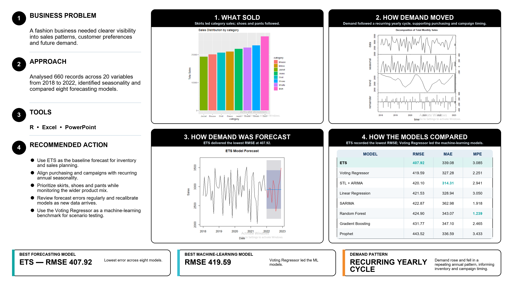

# Fashion Sales Forecasting & Trend Analysis

## Executive summary

This independent portfolio project analyzes fashion sales patterns and compares statistical and machine-learning forecasting approaches. The objective is to demonstrate how category performance, seasonality and model evaluation can support inventory, purchasing and campaign decisions.



## Business problem

A fashion business needs clearer visibility into sales patterns, product preferences and future demand so stakeholders can improve purchasing, inventory timing and campaign planning.

## Stakeholder requirements

- Identify the strongest-performing product categories.
- Determine whether recurring seasonal patterns affect demand.
- Produce an interpretable sales forecast.
- Compare forecasting approaches using a consistent error metric.
- Translate the findings into commercially relevant recommendations.

## Dataset

- 660 records
- 20 variables
- Period covered: 2018–2022
- Product, color, material and sales-related fields

### Data source and attribution

- **Dataset:** [Fashion Trend Dataset](https://www.kaggle.com/datasets/fashionworldda/fashion-trend-dataset)
- **Creator:** fashionworldda
- **Platform:** Kaggle
- **Date accessed:** October 10, 2026
- **File used:** `data/fashion_sales.csv`
- **Modifications:** Renamed the source file, reviewed data types and prepared the data for analysis.
- **License:** Refer to the license displayed on the Kaggle dataset page.

This project uses public portfolio data rather than confidential client information.

## Tools used

- R
- Excel
- Time-series analysis
- Forecasting
- Model evaluation

## Analytical approach

1. Cleaned and reviewed the sales fields.
2. Aggregated sales by category and month.
3. Examined product, color and material preferences.
4. Decomposed monthly sales to evaluate time, seasonal and remainder components.
5. Compared eight forecasting approaches.
6. Evaluated model performance using root mean squared error (RMSE).
7. Converted the analysis into inventory and campaign recommendations.

## Key insights

- Skirts led category sales, followed by shoes and pants.
- White and beige were leading colors in the analysis.
- Denim and leather were leading materials.
- The decomposition indicated a recurring annual seasonal pattern, supporting planned purchasing and campaign timing around periods that tend to repeat each year.
- ETS achieved the lowest overall RMSE at `407.92`.
- Voting Regressor led the machine-learning models with an RMSE of `419.59`.

## Recommendations

1. Use the ETS forecast as the primary planning baseline.
2. Align purchasing and campaign calendars with recurring annual seasonality.
3. Prioritize high-demand categories while monitoring changes in product mix.
4. Maintain safety stock for strong year-round products and use seasonal forecasts for variable-demand items.
5. Re-evaluate model performance as new sales data becomes available.

## Repository structure

```text
fashion-sales-forecasting/
├── analysis/
│   └── fashion_forecasting.R
├── data/
│   └── fashion_sales.csv
├── visuals/
│   └── fashion-sales-forecasting-poster.png
└── README.md
```

## Limitations

- The results depend on the scope and quality of the portfolio dataset.
- Forecast accuracy may change when applied to new periods or a different business.
- Seasonal patterns should be reassessed as more data becomes available.
- The analysis demonstrates a business workflow and should not be presented as an actual client engagement.

## Author

**Joy Ezike** — [Portfolio](https://joy-ezike.my.canva.site/) | [LinkedIn](https://www.linkedin.com/in/joy-ezike/)
